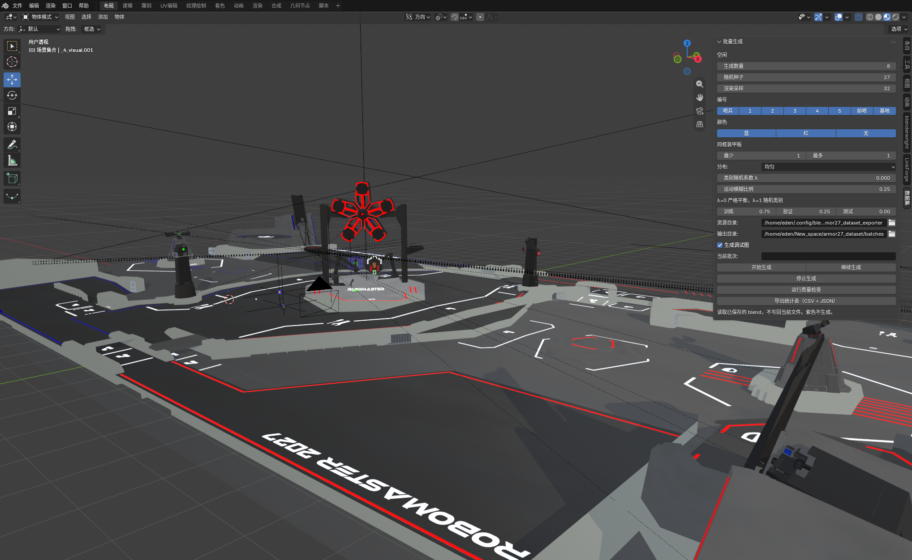
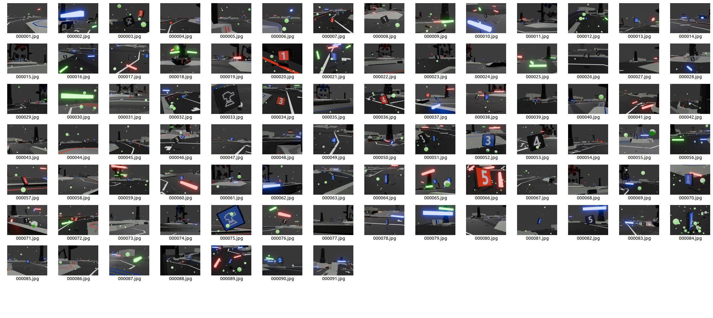
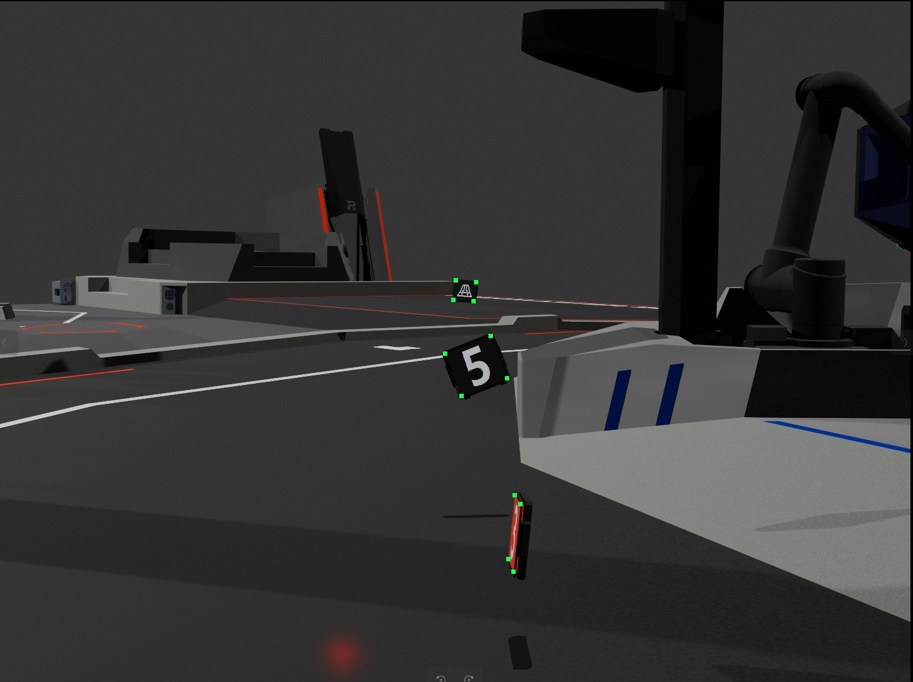

# Armor27 Dataset Exporter


面向 RoboMaster 装甲板识别的合成数据集生成工具。在 Blender 里设置数量、类别和颜色，后台批量渲染图片，并同步导出 17 字段关键点标签、划分清单和质量统计。



## 功能

- 在 3D 视图侧栏直接设置批次：数量、随机种子、类别、颜色、同框装甲板数量、训练/验证/测试比例。
- 后台启动独立的 Blender 进程渲染，不保存、不覆盖当前打开的文件。
- 每张图同步写出图片和标签，支持中途停止，并从随机数检查点继续。
- 类别平衡可调：λ = 0 时各类装甲板数量严格相等，λ = 1 时按块随机。
- 自动覆盖姿态、距离、遮挡、眩光、运动模糊和噪声。
- 批次结束后自动做质量检查，并导出 CSV 与 JSON 统计表。



## 环境要求

- Blender 5.2.0 或更高版本（在 5.2.1 上验证）
- 系统可执行文件 `python3`，用于质量检查和统计导出（只用标准库）
- 目前只在 Linux 上验证过

## 安装

1. 下载 [Releases](../../releases) 里的 `armor27-dataset-exporter-v1.0.0-full.zip`。
2. Blender → 编辑 → 偏好设置 → 插件 → 从磁盘安装，选择该 zip。
3. 搜索并启用 **Armor27 Dataset Exporter**。
4. 打开 3D 视图，按 `N` 展开侧栏，切换到 **数据集** 标签。

插件列表里的名称是 `Armor27 Dataset Exporter`，安装后的目录名是 `armor27_dataset_exporter`。

## 场地模型

仓库里的 `armor_newnewnew.blend` 只包含装甲板、相机和灯光，约 1 MB。场地模型 `RMUC2027.glb`（约 140 MB）随 Release 单独发布。

生成数据集前：

1. 从 Release 下载 `RMUC2027.glb`。
2. 放到 `armor_newnewnew.blend` 同一目录。
3. 在 Blender 里打开该 blend，文件 → 导入 → glTF 2.0，导入 `RMUC2027.glb`。
4. 确认场景里存在场地根对象 `00_RMUC20270001_ASM`，然后保存。

采样区域按这个场地对象计算。没有导入场地时，生成会因为找不到场地对象而失败。

## 使用

1. 在侧栏设置**资源目录**（包含 `armor_newnewnew.blend` 和 `IDs/` 的目录）和**输出目录**。
2. 选择生成数量、随机种子、编号和颜色。至少选一个编号和一个颜色。
3. 训练、验证、测试三项比例之和应为 1。
4. λ = 0 时，装甲板总数必须能被所选类别数整除，否则面板会提示调整数量。
5. 点击**开始生成**。进度、拒绝原因和错误显示在面板下方，完整日志在批次目录的 `generation.log` 和 `process.log`。
6. **停止生成**会在当前图片完成后停下并保留检查点；**继续生成**从最近一个含 `manifest.json` 的批次接着跑，类别、颜色、数量和 λ 必须与原批次一致。
7. 批次结束后自动运行质量检查和统计导出，也可以手动点击**运行质量检查**和**导出统计表（CSV + JSON）**。

紫色（`color_id` 2）不参与生成。

## 输出

```text
<输出目录>/<批次时间戳>/
├── images/{train,val,test}/
├── labels/{train,val,test}/
├── preview/                  # 勾选“生成调试图”时
├── manifest.json             # 每张图的姿态、材质、可见性和划分
├── coverage.json
├── generation.log
├── process.log
└── statistics/
    ├── report.json
    └── *.csv
```

标签为每块装甲板一行、17 个字段，坐标相对图像宽高归一化，原点在左上角：

```text
joint_id cx cy w h lt_x lt_y v lb_x lb_y v rb_x rb_y v rt_x rt_y v
```

四个角点依次为左上、左下、右下、右上。`joint_id = color_id × 9 + class_id`，可用 `joint_id // 9` 和 `joint_id % 9` 还原颜色和编号。角点可见性 `v`：0 无有效标注，1 被遮挡，2 可见。没有目标的图片写空标签文件。



## 这个仓库里有什么

| 路径                                                 | 内容                                    |
| ---------------------------------------------------- | --------------------------------------- |
| `src/armor27_dataset_exporter/`                      | 插件本体：入口、侧栏、生成、质检和统计  |
| `src/armor27_dataset_exporter/armor_newnewnew.blend` | 公开场景，随仓库提交                    |
| `src/armor27_dataset_exporter/IDs/`                  | 装甲板编号贴图                          |
| `RMUC2027.glb`                                       | 场地模型，仅通过 Release 分发，不进仓库 |

## 自行构建

```bash
python3 build_release.py
```

产物在 `build/`：

- `armor27-dataset-exporter-v1.0.0-addon.zip`：只有插件代码和配置，需要自己指定资源目录。
- `armor27-dataset-exporter-v1.0.0-full.zip`：包含场景和 `IDs/` 贴图。
- `armor27-dataset-exporter-v1.0.0-SHA256SUMS.txt`：上述两个文件的校验值。

`RMUC2027.glb` 不打进任何 zip，发布时作为 Release 附件单独上传。
